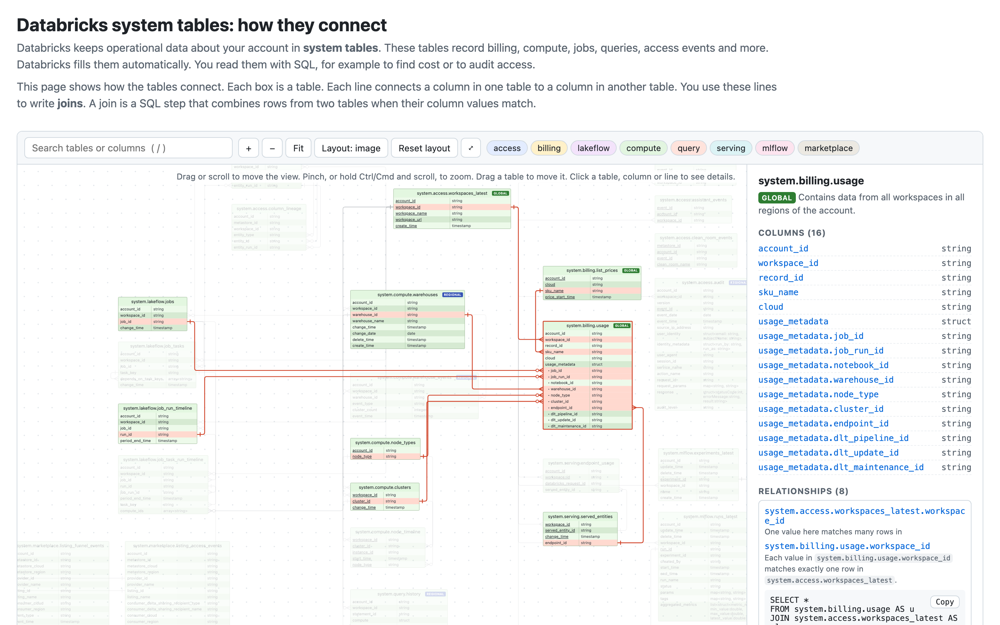

# Databricks system tables: how they connect

**Live page: https://oieduardorabelo.github.io/databricks-system-tables-relationships/**

Databricks keeps operational data about your account in system tables. These tables record billing, compute, jobs, queries and access events. You read them with SQL.

This repository is a web page with an interactive diagram of these tables. Each box is a table. Each line connects a column in one table to a column in another table. The page also explains scope (global or regional tables) and gives rules for good queries.

## What you can do on the page

- Drag or scroll to move the view. Pinch, or hold Ctrl/Cmd and scroll, to zoom.
- Drag a table to move it. Your browser keeps the new position.
- Click a table, a column or a line. The side panel shows the joins, with SQL that you can copy.
- Search for a table or a column. Show or hide each schema.
- Change the layout. "Layout: image" uses fixed positions. "Layout: auto (ELK)" uses [elkjs](https://github.com/kieler/elkjs) to place the tables and draw the lines around them.
- Share a link to one table or column, for example `#system.billing.usage.usage_metadata.warehouse_id`.

## What it covers

Every system table: 58 tables in 18 schemas of the `system` catalog. It leaves out `system.information_schema`, which describes data objects, not account activity. Each box shows its key columns first. "+ more columns" shows every column.

- Column lists come from Unity Catalog in a Databricks workspace, through the Databricks CLI.
- Schemas that were not enabled in that workspace (`data_classification`, `data_quality_monitoring`, `lakebase`, `marketplace`, `replication`) use the columns in the Databricks docs.
- Scope (global or regional) and release status (preview, beta, unlisted) come from the Databricks docs.

## Files

| File | What it does |
| --- | --- |
| `data.js` | Written by hand. Key columns, primary keys, lines, scope, release status and positions. |
| `columns.js` | Generated. Every real column and type, and the table descriptions. Do not edit it by hand. |
| `app.js` | Draws the diagram and handles clicks, drags and search. It needs no other library. It loads elkjs from unpkg only when you select the automatic layout. |
| `styles.css` | Sets colours and layout. |
| `index.html` | Holds the page text. |
| `scripts/` | Exports the system catalog and builds `columns.js`. |

## Update the column lists

You need the [Databricks CLI](https://docs.databricks.com/aws/en/dev-tools/cli/) and a profile for a workspace with Unity Catalog.

1. Run `scripts/export-system-tables.sh <profile>`. The raw export goes to `scripts/.uc-export/`. Git ignores this folder, because it has workspace details.
2. Run `python3 scripts/build-columns.py`. This writes `columns.js`.
3. Open the page. The browser console warns about any line in `data.js` that points to a column that no longer exists.

## Run the page on your computer

1. Open a terminal in this folder.
2. Run `python3 -m http.server 8765`.
3. Open http://localhost:8765 in a browser.

## Publish changes

GitHub Pages publishes the `main` branch from the root folder. Each push to `main` updates the live page in about one minute.
